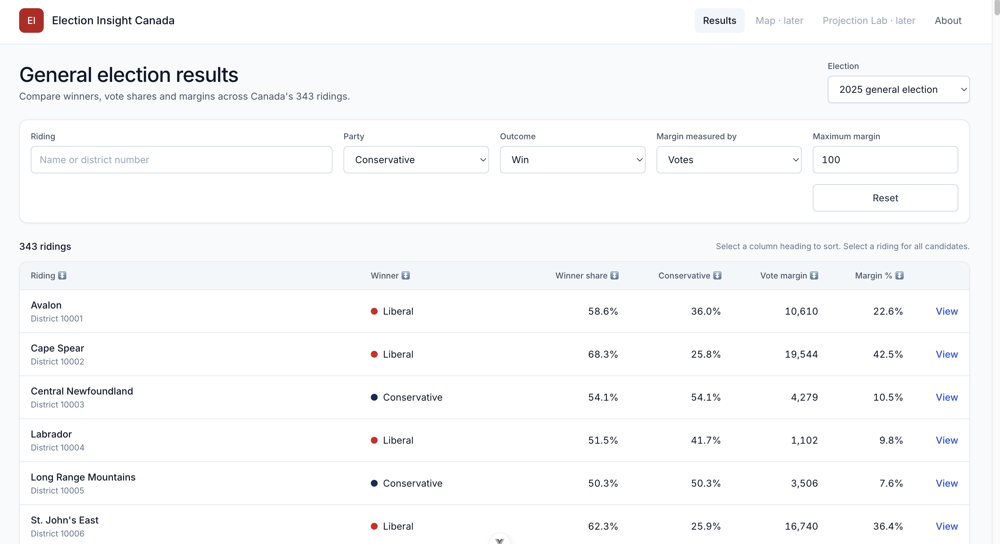

# 🇨🇦 Election Insight Canada

A full-stack data application for exploring Canadian federal election results, built with Python, FastAPI, PostgreSQL, Vue and TypeScript.

The initial PostgreSQL ETL pipeline and FastAPI backend are complete. The Vue frontend now loads 2025 riding results and political-party data through a tested API client and Pinia store. Current development is focused on client-side filtering, sorting and pagination.

**Current focus:** Building the interactive 2025 riding-results table using Vue, TypeScript, Pinia and Tailwind CSS.


---

## 🧩 The Problem

### 🗳️ 1. Estimating seat counts from polling data

Canada uses a **first-past-the-post** electoral system with multiple parties. The 2025 federal election was contested across 343 individual ridings, and translating national polling percentages into seat counts is not straightforward.

Key challenges include:

- **Regional concentration of support**  
  Parties like the _Bloc Québécois_ can win many seats with relatively low national vote share.

- **Vote splitting**  
  Parties competing for similar voters (e.g., Liberal vs NDP, Conservative vs PPC) can significantly affect outcomes.

- **Close races (swing ridings)**  
  Many ridings are decided by small margins, where even minor vote shifts can change the winner.

- **Regional dynamics**  
  Voting patterns vary significantly across provinces (Prairies, Ontario, Quebec, Atlantic Canada).

Because of these factors, national polling results do **not directly translate** into seat projections.

---

### 📊 2. Working with Elections Canada data

Elections Canada provides detailed CSV datasets, but they are difficult to work with directly.

Common challenges:

- Data is split across many files (one file for each of the 343 ridings)
- Significant redundancy within and across datasets
- Hard to answer simple analytical questions (e.g., “Which ridings were decided by fewer than 300 votes?”)
- When combined, the number of rows of data for just the 2025 election is 476,685, making it hard to analyze in Excel

This project transforms raw election data into a structured, queryable format.

---

## ⚙️ Technical Highlights

- Built a REST API with Python and FastAPI for querying Canadian federal election results
- Designed a normalized PostgreSQL schema for Elections Canada election data
- Built Python data-loading tools to transform and load 2025 poll-by-poll election results into PostgreSQL
- Developed analytical SQL queries using joins, CTEs, aggregate functions, and window functions
- Created API endpoints for riding-level election results and identifying close ("swing") ridings
- Defined structured API response models using Pydantic
- Built automated backend tests with pytest
- Used environment-based configuration for database credentials and development settings
- Built a typed frontend API client with structured error handling and request cancellation
- Added explicit API-to-application mappers and TypeScript data models
- Integrated FastAPI data with a Pinia store and Vue components
- Added loading, error, retry and request-cancellation state
- Configured CORS for local frontend development
- Added frontend component, API-client, mapper and store tests with Vitest and Vue Testing Library

---

## Screenshot



_Figure 1. The Vue results table displaying 2025 federal election data loaded from the FastAPI backend._

## 🚀 What This Project Does

### 🧠 Core Capabilities (Current / Phase 1)

- Ingests official Elections Canada CSV data
- Stores data in a normalized PostgreSQL database
- Provides structured access via a FastAPI backend
- Enables queries such as:
  - Results by riding
  - Candidate vote breakdowns
  - Identifying swing ridings (close races)

---

### 🔮 Planned Features (Future Phases)

- Seat projections based on national polling data
- Interactive vote share sliders
- Instant seat-projection updates as vote assumptions change
- Interactive map visualization
- Historical election comparisons
- Filtering by party, province, and riding

Development priorities and planned features are tracked in the [detailed roadmap](docs/roadmap.md).

---

## 🏗️ Project Structure

```text
election-insight-canada/
│
├── backend/
│   ├── app/
│   ├── common/
│   ├── db/
│   │   ├── queries/
│   │   └── schema.sql
│   ├── loaders/
│   ├── scripts/
│   ├── tests/
│   └── pyproject.toml
│
├── data/
│   ├── raw/
│   ├── reference/
│   └── processed/
│
├── frontend/
│   ├── src/
│   │   ├── api/
│   │   ├── assets/
│   │   ├── components/
│   │   ├── mappers/
│   │   ├── mocks/
│   │   ├── router/
│   │   ├── stores/
│   │   ├── types/
│   │   ├── views/
│   │   ├── App.vue
│   │   └── main.ts
│   └── package.json
│
├── docs/
│   ├── elections-canada-data-dictionary.md
│   └── roadmap.md
│
├── README.md
├── LICENSE
├── CONTRIBUTING.md
├── package.json
├── yarn.lock
└── .gitignore
```

## 🛠️ Tech Stack

- **Frontend:** Vue 3, TypeScript, Pinia and Vue Router
- **Styling:** Tailwind CSS 3
- **Backend:** Python and FastAPI
- **Database:** PostgreSQL
- **Backend testing:** pytest and Coverage.py
- **Frontend testing:** Vitest, Vue Testing Library and jsdom
- **End-to-end testing:** Playwright (configured; tests pending)
- **Package and environment tools:** Yarn and uv

---

## 🗺️ Development Roadmap

The 2025 election data pipeline and initial FastAPI backend are complete.
Current development is focused on adding functional filtering, sorting and pagination to the Vue riding-results table.

### Current priorities

- Implement client-side filtering and sorting
- Add pagination to the riding-results table
- Connect the existing controls to Pinia state
- Add tests for the interactive table behaviour

### Later phases

- Deploy the application to Linode
- Add an interactive riding map
- Support historical elections and by-elections
- Develop and backtest polling-based seat-projection models

See the [detailed development roadmap](docs/roadmap.md) for planned work and current progress.

---

## 🛠️ Local Setup

The following instructions set up the current development version locally. The setup process is still being improved and has primarily been tested on macOS.

### 📋 Prerequisites

For the backend and data pipeline:

- PostgreSQL
- Python 3.13 or higher
- uv

For the Vue frontend:

- Node.js
- Yarn

### 1. Clone the repository

```bash
git clone https://github.com/Tom-js-python/election-insight-canada
cd election-insight-canada
```

### 2. Install the dependencies

```bash
yarn setup
```

### 3. Configure PostgreSQL

Connect to PostgreSQL using an administrative role. Depending on your installation, this may be:

```bash
psql -U postgres -d postgres
```

In the psql terminal type:

```sql
SHOW PORT;
CREATE DATABASE election_insight_canada;
CREATE ROLE eic_computer_access WITH LOGIN;
\password eic_computer_access

\connect election_insight_canada
GRANT ALL ON SCHEMA public TO eic_computer_access;
\q
```

### 4. Configure environment variables

Copy the example environment files and update the values for your local environment.

```bash
cp ./backend/.env.example ./backend/.env
cp ./frontend/.env.example ./frontend/.env.development
```

Configure the backend database connection values in `backend/.env`.

Configure the frontend API location in `frontend/.env.development`:

```env
VITE_API_BASE_URL=http://localhost:8000
```

### 5. Create the database tables

```bash
yarn db:create-tables
```

### 6. Download Elections Canada data

Go to <>. Download the data for Canada / poll-by-poll results, format 2, to the data/raw directory. Unzip this file.

### 7. Load the data

```bash
yarn db:load-2025-csv
```

### 8. Run the development server

```bash
yarn dev
```

Once both development servers are running, the application is available at:

- Vue frontend: <http://localhost:5173>
- FastAPI documentation: <http://localhost:8000/docs>
- Health endpoint: <http://localhost:8000/health>

### 9. Run the tests, type checks, linting and formatting before committing

```bash
yarn precommit
```

---

## 🧠 Why This Project?

This project sits at the intersection of:

- **Software development**
- **Data analysis**
- **Public policy**

With a background in both programming and public administration, I’m interested in building tools that make complex real-world systems more understandable.

Canadian elections are a great example: simple on the surface, but deeply complex in practice.

---

## 📚 Documentation

- [Development roadmap](docs/roadmap.md)
- [Elections Canada data dictionary](docs/elections-canada-data-dictionary.md)
- [API documentation](http://localhost:8000/docs) — available while the backend is running
- [Contributing guide](CONTRIBUTING.md)

---

## 🔌 API

The FastAPI backend currently provides endpoints for exploring the 2025 Canadian federal election.

### Riding Results

`GET /ridings/all/2025`

Returns election results for Canadian federal electoral districts, including candidate and party vote totals.

### Political Parties

`GET /political-parties`

Returns canonical political-party data, including stable keys and English and French source, long-display and short-display names.

### Swing Ridings

`GET /ridings/swing/2025`

Returns close races for a selected political party.

Required query parameters:

- `party_key`: the stable key identifying the political party;
- `outcome`: one of `win`, `loss` or `both`;
- exactly one of:
  - `max_margin_votes`;
  - `max_margin_percentage_points`.

Example:

```http
GET /ridings/swing/2025?party_key=conservative&outcome=win&max_margin_votes=1000`
```

Interactive API documentation is available through FastAPI's Swagger UI at <http://localhost:8000/docs> when the backend is running locally.

---

## 🧪 Testing

The backend includes an automated pytest suite covering API routes, request validation, response structure and shared application logic. More comprehensive ETL integration testing is planned.

Run the backend tests with:

```bash
yarn backend:test
```

The frontend includes an automated Vitest unit test suite.

Run the frontend tests with:

```bash
yarn frontend:test
```

End-to-end testing with Playwright is configured, but the tests have not yet been implemented.

---

## 👋 Creator

Built and maintained by **Tom Brown**

- [GitHub](https://github.com/Tom-js-python)
- [LinkedIn](https://www.linkedin.com/in/thomas-brown-823364326/)

---

## 🤝 Contributing

Contributions, bug reports and implementation suggestions are welcome.

Before beginning a substantial change, please open an issue so the proposed approach can be discussed. Development conventions, testing commands and the pull-request process are documented in [CONTRIBUTING.md](CONTRIBUTING.md).

Issues suitable for new contributors are labelled `good first issue`.

---

## 📄 License

This project is open source under the [Apache 2.0 License](https://www.apache.org/licenses/LICENSE-2.0).

You are free to use, modify, and distribute it under the terms of the license.
